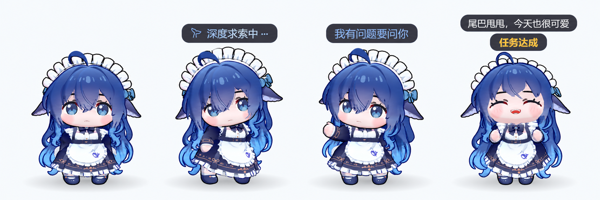
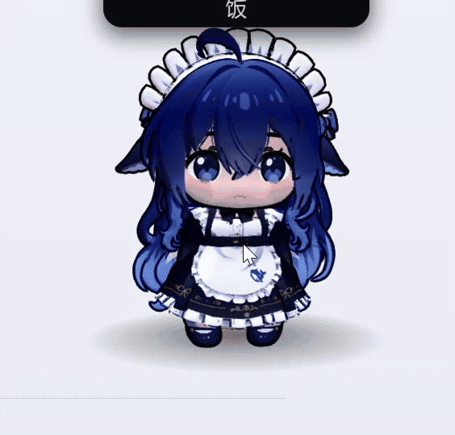

# 桌宠 3D · VRM Pet 3D

为 **DeepSeek Harness（DSH）** 添加一只随任务状态活动的 3D 桌宠。支持应用内显示，以及 DSH Desktop 上独立的透明悬浮窗；任务进行、等待确认、完成或出错时，宠物会显示对应状态并播放配置的动作。

自带两款模型和 VRMA 动作包，安装后即可使用。可导入自己的模型，设置动作、表情、视线和物理效果，也可以让宠物说预设台词或使用 AI 生成碎碎念。

[安装与使用](#安装) · [问题反馈](https://github.com/drliuhuan/dsh-plugin-vrmpet3d/issues) · [MIT 许可证](LICENSE)

[English](#english)

> 当前为早期版本，仍在修复和完善。3D 渲染会占用 GPU 与内存；遇到异常时，请附上 DSH 版本、显示方式和复现步骤反馈。

```
no runtime dependencies · 9 verification suites · 2637 checks · works offline
```

## 效果展示

空闲、工作中、等待确认与任务完成的状态展示合成图：



碎碎念与鼠标凝视的实机演示：



展示模型为 **BlueFatFish / 蓝色小肥鱼Deepseek**，作者 **木子恶魔**，
[原始发布页](https://www.aplaybox.com/details/model/ayXkRzVflmnd)。**经作者授权随本插件分发，需注明来源与作者。**
模型版权归原作者，其授权独立于插件代码的 MIT 许可证。模型选择页及首次引导的模型步骤也展示相同署名、授权与来源。

市场截图顺序由根目录 [screenshots.json](screenshots.json) 声明，包含合成展示图和四张原始截图。

## 功能

| 功能 | 说明 |
| --- | --- |
| 两种显示方式 | 应用内宠物；Desktop 端自动开启独立悬浮窗，支持置顶和透明区域鼠标穿透 |
| 任务状态联动 | 空闲、工作中、等待确认、完成、出错与离线；空闲保持 idle，不自动进入休眠 |
| 模型 | VRM 1.0 / 0.x，兼容普通 glTF/GLB；人体动作播放需要 VRM 骨架 |
| 动作 | 自带 VRMA 动作包，可按状态配置循环、单次、速度、表情、口型和凝视 |
| 跳支舞 | 右键随机播放一支舞蹈；播完、双击或开始工作时结束 |
| 互动 | 点击与长按部位触发表情和碎碎念；拖动、缩放、旋转视角、视线跟随和弹簧骨物理 |
| 碎碎念 | 内置台词、自定义台词，或使用 DSH 模型 / OpenAI 兼容接口生成 AI 台词 |
| 导入 | 模型以文件导入、动作包以文件夹导入，复制到插件存储后不依赖原路径 |
| 界面语言 | 全部界面中英双语，默认跟随系统 / DSH 自动识别；「通用设置 → 显示与外观」和初次引导欢迎页各有一个语言选择（自动 / 中文 / English） |

## 运行要求

- 已在 DeepSeek Harness **0.2.0-rc.2** 上验证；其他版本尚未验证，不代表无法使用。本项目是 DSH 插件，不能作为独立应用运行。
- 支持 WebGL2 的图形环境。独立悬浮窗需可用的 Electron 运行时，由启动器从 DSH 安装目录复用；无法启动时回退到应用内显示。
- 无需安装运行时 npm 依赖。默认台词和模型动画可离线使用；AI 碎碎念取决于所选服务的网络与额度。

## 安装

请使用本仓库的 **main 分支**安装。项目尚未发布到 npm。

1. 在 DSH 插件管理器中添加本仓库；支持 GitHub 包来源时，使用：

   ```text
   github:drliuhuan/dsh-plugin-vrmpet3d#main
   ```

2. 也可以[下载 main 分支 ZIP](https://github.com/drliuhuan/dsh-plugin-vrmpet3d/archive/refs/heads/main.zip)，解压后在插件管理器中添加包含 `package.json` 的文件夹，或填写 `link:<插件文件夹的绝对路径>`。
3. 确认插件已启用，然后重启 DSH。更新插件后也请重启，确保宿主代码和页面代码使用同一版本。

请先停用其他占用同一桌宠显示位置的插件，例如 `dsh-plugin-fatfish-pet`、`dsh-plugin-whale-pet`。卸载时从插件管理器移除本插件。

## 首次使用

首次引导会依次配置偏好模型、桌宠界面和 AI 碎碎念。可稍后配置，也可在 **通用设置 → 其他 → 重新运行引导** 再次打开。

- **切换显示方式**：Desktop 的通用设置最上方可选“内置宠物”或“自动”；自动优先使用独立悬浮窗。右键菜单也可以切换。
- **切换模型**：右键 → 切换模型，点击缩略图；可拖入自己的模型文件，加载进度结束后再继续切换。
- **设置动作**：通用设置 → 状态与动作。默认映射、表情和播放方式已随动作包提供，可以自行修改。
- **设置台词**：通用设置 → 碎碎念。选择内置、自定义或 AI 来源；AI 模式需要先选择可用服务和模型。
- **设置表情与部位**：右键 → 当前模型参数设置。模型结构不同，可用表情、部位和弹簧骨链也会不同。

### 鼠标操作

| 操作 | 效果 |
| --- | --- |
| 点击 / 原地长按 | 触发部位互动与碎碎念，保留正在播放的动作 |
| 左键拖动 | 移动宠物；开启对应界面的重力后，松开可触发抛掷和落地 |
| 滚轮经过宠物 | 调整宠物及其文字大小 |
| 滚轮经过文字 | 单独调整文字大小 |
| 右键拖动 | 旋转观察视角 |
| 右键点击 | 打开菜单：显示切换、模型切换、跳舞、重载、设置、重力和隐藏等 |
| 双击 | 结束当前跳舞 |

## 模型、动作与数据

自带默认模型 **蓝色小肥鱼Deepseek（木子恶魔）**，以及备用模型 **ヴィータ（VRoid プロジェクト）**。来源和授权见下方许可证说明及[模型说明](assets/models/README.md)。

### BlueFatFish 模型署名与授权

| 项目 | 信息 |
| --- | --- |
| 模型文件 | `BlueFatFish.vrm.br`（加载时解压为 VRM） |
| 模型名称 | 蓝色小肥鱼Deepseek |
| 作者 | 木子恶魔 |
| 来源 | [Aplaybox 原始发布页](https://www.aplaybox.com/details/model/ayXkRzVflmnd) |
| 分发授权 | 经作者授权随本插件分发，需注明来源与作者 |

本项目的 MIT 许可证不替代模型作者的授权；其他用途仍以作者原始发布页的条款和另行授权为准。

模型支持 `.vrm`、`.glb`、`.gltf`，动作支持 `.vrma`；不支持 PMX/PMD 或 VMD。普通 glTF/GLB 没有 VRM 人体骨架时，不能播放 VRMA 人体动作。自带模型与动作使用 Brotli 压缩存储，加载时自动解压。

导入内容与配置保存在 DSH profile 的插件存储目录中。移除导入只删除插件持有的副本，不删除原文件。随包动作的默认设置按文件名解析，不依赖其他机器上的模型或动作 ID。

### AI 与隐私

宠物通过任务状态、会话标识和计时信息判断当前状态，不需要读取会话正文、工具参数或附件。启用 AI 碎碎念后，所配置的人格、状态提示词和部位信息会发送给你选择的 AI 服务；费用与数据处理规则由该服务决定。

### 常见问题与反馈

- **没有宠物**：检查插件管理器里是否仍已启用，重启 DSH，并确认未被其他桌宠插件占用显示位置。
- **没有独立窗口**：在通用设置中选择“自动”；若运行时不可用，仍可使用内置宠物。
- **模型不播放动作**：确认使用 VRM 模型，状态下选有动作，并开启模型动作。反馈时请附上完整错误提示。
- **AI 不说话**：检查台词来源、服务、模型和访问额度；可以先切回内置台词确认气泡显示正常。

请通过 [GitHub Issues](https://github.com/drliuhuan/dsh-plugin-vrmpet3d/issues) 提交问题，附上 DSH 版本、操作系统、内置/外置显示方式、复现顺序与预期结果。请勿上传 API Key 或私人会话内容。

## English

Add a 3D desktop pet to **DeepSeek Harness (DSH)**. The pet follows task states and can appear inside the app or in a separate transparent floating window on DSH Desktop. It shows the current state and plays its assigned motion while a task is running, waiting for confirmation, completed, or has failed.

Two models and a VRMA motion pack are included. You can import your own models, configure motions, expressions, gaze and physics, and let the pet speak preset lines or generate AI chatter.

[Installation and usage](#installation) · [Report an issue](https://github.com/drliuhuan/dsh-plugin-vrmpet3d/issues) · [MIT license](LICENSE)

> This is an early release and is still being improved. 3D rendering uses GPU and memory. When reporting a problem, include your DSH version, display mode and reproduction steps.

### Screenshots and demo

The composite shows the idle, working, waiting for confirmation and task completed states:


Live demo of chatter and mouse gaze:


The model shown is **BlueFatFish / 蓝色小肥鱼Deepseek**, by **木子恶魔**. See the [original release](https://www.aplaybox.com/details/model/ayXkRzVflmnd). **The author authorized distribution with this plugin, provided the source and author are credited.** The model remains the author's work and is covered separately from the plugin's MIT license. The same attribution, authorization and source are shown in the model picker and the first-run guide.

The marketplace screenshot order is declared in the root [screenshots.json](screenshots.json), which lists the composite and four original screenshots.

### Features

| Feature | Description |
| --- | --- |
| Two display modes | In-app pet, or an automatically opened floating window on Desktop with always-on-top and transparent-area click-through support |
| Task state tracking | Idle, working, waiting for confirmation, completed, failed and offline; idle stays in the idle state and does not automatically sleep |
| Models | VRM 1.0 / 0.x and regular glTF/GLB; humanoid VRM bones are required for character motions |
| Motions | Included VRMA pack with per-state loop, one-shot, speed, expression, lip-sync and gaze settings |
| Dance | Right-click to play a random dance; it ends when the motion finishes, on double-click, or when work starts |
| Interaction | Click or hold body parts for expressions and chatter; drag, resize, rotate the view, follow the pointer and use spring-bone physics |
| Chatter | Built-in or custom lines, or AI-generated lines using a DSH model or an OpenAI-compatible service |
| Import | Import models as files and motion packs as folders. Imported files are copied into plugin storage and no longer depend on their original paths |
| Language | The whole interface is Chinese and English, auto-detected from the system or DSH by default; a chooser (Auto / 中文 / English) sits in General settings → Display, and on the first-run guide's welcome screen |

### Requirements

- Verified with DeepSeek Harness **0.2.0-rc.2**. Other versions have not been verified; this does not mean they cannot work. This is a DSH plugin and cannot run as a standalone application.
- A graphics environment with WebGL2. The floating window requires an available Electron runtime, which the launcher reuses from the DSH installation. If it cannot start, the pet falls back to the in-app display.
- No runtime npm dependencies are required. Built-in lines and model motions work offline. AI chatter depends on the selected service's network access and usage quota.

### Installation

Install from this repository's **`main` branch**. The project is not published on npm yet.

1. Add this repository in the DSH plugin manager. If it accepts GitHub package sources, use:

   ```text
   github:drliuhuan/dsh-plugin-vrmpet3d#main
   ```

2. You can also [download the `main` branch ZIP](https://github.com/drliuhuan/dsh-plugin-vrmpet3d/archive/refs/heads/main.zip), extract it and add the folder containing `package.json` in the plugin manager, or enter `link:<absolute path to the plugin folder>`.
3. Make sure the plugin is enabled, then restart DSH. Restart after updates as well so the host and page code use the same version.

Disable other plugins that use the same pet display position first, such as `dsh-plugin-fatfish-pet` and `dsh-plugin-whale-pet`. Uninstall this plugin through the plugin manager.

### First run

The first-run guide configures your preferred model, pet display and AI chatter. You can finish setup later, or reopen it from **General Settings → Other → Run setup guide again**.

- **Choose a display mode:** On Desktop, select “Built-in pet” or “Automatic” at the top of General Settings. Automatic mode prefers the separate floating window. You can also switch modes from the right-click menu.
- **Choose a model:** Right-click → Switch model, then select a thumbnail. You can also drop in a model file; wait for loading to finish before switching again.
- **Configure motions:** General Settings → States and motions. Default state mappings, expressions and playback settings are included and can be changed.
- **Configure lines:** General Settings → Chatter. Choose built-in, custom or AI lines. AI mode requires an available service and model.
- **Configure expressions and body parts:** Right-click → Current model settings. Available expressions, body parts and spring-bone chains depend on the model.

#### Mouse controls

| Action | Result |
| --- | --- |
| Click / hold in place | Trigger body-part interaction and chatter while preserving the current motion |
| Drag with left button | Move the pet; when gravity is enabled for that display, release to throw it and let it land |
| Scroll over the pet | Resize the pet and its text |
| Scroll over text | Resize the text only |
| Drag with right button | Rotate the view |
| Right-click | Open the menu for display and model switching, dancing, reloading, settings, gravity, hiding and more |
| Double-click | End the current dance |

### Models, motions and data

The bundled default model is **蓝色小肥鱼Deepseek by 木子恶魔**. The alternate model is **ヴィータ by VRoid プロジェクト**. See the license notes below and the [model documentation](assets/models/README.md) for their sources and terms.

#### BlueFatFish model attribution and authorization

| Item | Information |
| --- | --- |
| Model file | `BlueFatFish.vrm.br` (decompressed to VRM when loaded) |
| Model name | 蓝色小肥鱼Deepseek |
| Author | 木子恶魔 |
| Source | [Original Aplaybox release](https://www.aplaybox.com/details/model/ayXkRzVflmnd) |
| Distribution authorization | The author authorized distribution with this plugin, provided the source and author are credited |

The project's MIT license does not replace the model author's authorization. Other uses remain subject to the terms on the original release page and any separate authorization from the author.

Models support `.vrm`, `.glb` and `.gltf`; motions support `.vrma`. PMX/PMD and VMD are not supported. Regular glTF/GLB files without a VRM humanoid skeleton cannot play VRMA character motions. Bundled models and motions are stored with Brotli compression and decompressed automatically when loaded.

Imported files and settings are stored in the plugin storage directory in the DSH profile. Removing an import deletes only the plugin's copy, not the original file. Default settings for bundled motions are resolved by filename and do not depend on model or motion IDs from another machine.

#### AI and privacy

The pet uses task state, session identifiers and timing information to determine its current state. It does not need to read conversation text, tool arguments or attachments. When AI chatter is enabled, the configured personality, state prompt and body-part information are sent to the AI service you select. That service determines its own fees and data handling rules.

#### Troubleshooting and feedback

- **The pet is missing:** Check that the plugin is enabled, restart DSH, and make sure another pet plugin is not using the same display position.
- **The floating window is missing:** Select “Automatic” in General Settings. The in-app pet remains available if the runtime cannot start.
- **The model does not move:** Confirm that you are using a VRM model, that a motion is assigned to the current state, and that model motions are enabled. Include the full error message when reporting the issue.
- **AI is silent:** Check the line source, service, model and usage quota. Switch to built-in lines to confirm that the speech bubble works.

Report issues through [GitHub Issues](https://github.com/drliuhuan/dsh-plugin-vrmpet3d/issues). Include your DSH version, operating system, display mode, reproduction steps and expected result. Do not upload API keys or private conversation content.


## Verification

**9 verification suites, 2637 checks** — and they live on the **`dev` branch**: this branch carries the plugin
itself, and the suites, the `build/probe` bodies and the working notes are kept beside the development. Fetch `dev`
before running any of the commands below. The narrow suite for a change is in [AGENTS.md](AGENTS.md); the whole tree is
one command, and it is the operator's call rather than a reflex:

```bash
node scripts/verify-all.mjs     # runs the nine below, cheapest first
```

| Command | Checks |
|---|---|
| `node scripts/verify.mjs` | 1316 — state machine, the nine motion states, the session aggregate's completion rules (a helper's stop is not the user's, a completion that gets retracted doubles that session's settle window, and WHY a notice ended is recorded), the shipped 部位 碎碎念 (两个手势 × 中英), 界面语言 (the preference, the resolver and the shared text machinery), and the pack's 状态与动作 template (per-clip 循环/表情/口型/凝视, merged field by field under the profile's own) |
| `node scripts/verify-model.mjs` | 824 — model catalog, the import stores, the thumbnail route, the shipped motion mapping and its per-clip template, the live-state channel's WHY block (including the last dismissal), the first-run guide's state, and the whale mark's source chain (read out of the running DSH at activation, then the packaged file, then the cached copy, then nothing) |
| `node scripts/verify-browser.mjs --page chunk-delivery` | 39 — DSH's own module system delivering the committed chunks |
| `node scripts/verify-browser.mjs` | 13 — the 3D stack, framing and loaders in a real browser |
| `node scripts/verify-browser.mjs --page client-test` | 111 — the widget, the menu, the desktop page, the shipped 部位 台词 per gesture, the background pump that keeps a throttled window alive, the pack template through a real scene, the guide, its trigger, the model picker's page (progress bar, lock and the live report that ends it), the one-shot playback rules on a real avatar, a posed model's part hit test, and 通用设置's 状态与动作 rows with their per-clip 碎碎念 and AI 提示词 |
| `node scripts/verify-desktop.mjs` | 332 — the pet's own window, borrowed Electron and all, plus the four pages' scripts and the 界面语言 markup contract (every `data-i18n` key has a table entry, and each table's two halves hold the same keys) |
| `node scripts/check-plugin-load.mjs` | the manifest, activation and clean disposal |
| `node scripts/vendor-build.mjs --check` | the committed 3D chunk is reproducible from the pinned versions |
| `node scripts/check-docs.mjs` | documented paths, commands and counts match reality |

The suites that need a browser skip (not fail) without one, and `verify-desktop.mjs` skips when there is no
installation to borrow an Electron from. Two habits this project cares about: after editing
[lib/core.js](lib/core.js), [lib/scene.js](lib/scene.js) or [lib/menu.js](lib/menu.js) run
`node scripts/client-chunks.mjs` (the delivered chunks are committed copies, and a stale one is a silent failure —
`--check` is the one-second assertion), and report a partial run as a partial run ("core: 1042 passed"), never as
"all green".

**Verification is a developer's instrument, and installing the plugin never runs it.** The packaged artifact
(`files[]`) ships no `scripts/`, so an installation — through the plugin manager, a package manager, or a
`github:` spec — receives the pet and not the suites; nothing in the plugin's own code calls one. The `desktop`
suite is the only one that opens a **real always-on-top window** on the machine running it (it has to, to prove
the window it makes), so a pass that should not disturb anyone asks for it to be left out:

```bash
node scripts/verify-all.mjs --no-window      # the same nine suites; that suite's live half is skipped and says so
node scripts/verify-desktop.mjs --no-window  # or VRMPET3D_SKIP_DESKTOP=1, for that one suite
```

The desktop suite's Node half still runs, the skip is printed rather than passed silently, and
`node scripts/check-docs.mjs` measures the documented count with the live half forced back ON, so the figure above
never depends on who ran it.

## Project layout

```
lib/        the plugin: core.js (rules) · index.js (host routes) · scene.js (renderer)
            client.js (in-app pet) · desktop-page.js (floating window) · config-page.js (settings)
            client.*.js — the DELIVERED chunks, generated, never hand-edited
desktop/    the launcher: the window, the always-on-top rules, the self-test
scripts/    the suites and the tools
docs/       ARCHITECTURE.md (design) · ASSET-CONTRACT.md (model/motion files) · models/
assets/     the two bundled models (BlueFatFish.vrm.br · SampleModel.vrm.br)
vendor/     the pinned 3D stack (build-time only; the chunk is committed)
```

## Documentation

* [docs/ARCHITECTURE.md](docs/ARCHITECTURE.md) — how it is put together and why, in depth.
* [HANDOFF.md](HANDOFF.md) — the current state: what to do next, frozen zones, environment facts, gotchas.
* [AGENTS.md](AGENTS.md) — the working rules: which suite covers which change, and what "partial" never means.
* [docs/ASSET-CONTRACT.md](docs/ASSET-CONTRACT.md) — what a model or motion file must be, and the retired MMD
  chapters.

## License

插件代码与本项目原创动作采用 MIT 许可证。模型资源仍遵守各自作者的授权，不因随本仓库分发而自动改为 MIT。

MIT — see [LICENSE](LICENSE). It bundles other MIT-licensed software as one generated file
([lib/client.vendor.js](lib/client.vendor.js)): three.js, `@pixiv/three-vrm` and `@pixiv/three-vrm-animation`. It
ships exactly two 3D model files, and both may be redistributed with it:

| file | model | author | source | terms |
| --- | --- | --- | --- | --- |
| [assets/models/BlueFatFish.vrm.br](assets/models/BlueFatFish.vrm.br) | 蓝色小肥鱼Deepseek | 木子恶魔 | <https://www.aplaybox.com/details/model/ayXkRzVflmnd> | 经作者授权分发 — credited here as the author asks |
| [assets/models/SampleModel.vrm.br](assets/models/SampleModel.vrm.br) | ヴィータ | VRoid プロジェクト | <https://vroid.com/en/studio> | its own embedded licence: redistribution, modification and commercial use allowed, no attribution required |

The first is what a fresh profile resolves to; the second is the fallback. Every other model is the user's and stays
under its own author's terms.
